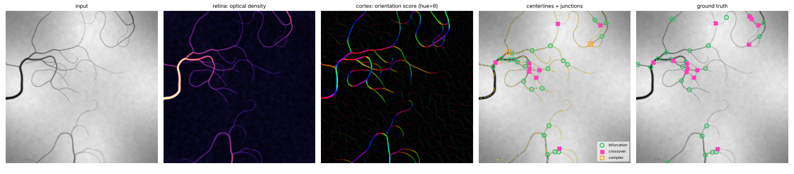
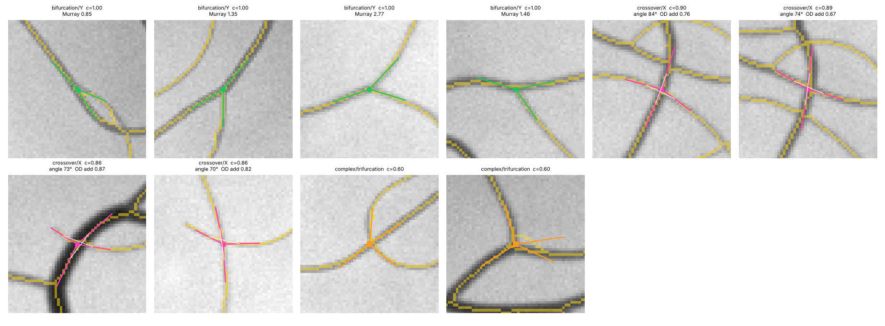

# vascnet — a fixed-weight visual cortex for vessel centerlines and junctions

`vascnet` traces the centerlines of vessel-like networks (blood vessels, but also
branches, roots, leaf venation, neurites) and finds and classifies their
junctions — **bifurcations, crossovers, contacts and complex junctions** —
for automated annotation of stabilized video.

**Nothing is learned.** Every weight is a hand-built receptive field with a
stated job, borrowed from how the early visual system is wired: retinal
luminance adaptation, oriented even/odd simple cells, end-stopping,
recurrent horizontal connections, cross-orientation inhibition and divisive
normalization. The rules for reading a junction are the perceptual ones: good
continuation, similarity, transparency and amodal completion. All thresholds
are signal-to-noise ratios that are re-measured on every image. That is why
one set of constants works across noise, blur, contrast, texture, density and
tortuosity without retuning (see [Results](#results)).





*Arms are drawn from each junction; white ticks join arms judged to be the same
vessel. Crossovers report their crossing angle and the optical-density
additivity at the overlap. Bifurcations report their Murray's-law ratio.*

---

## Architecture

```
 image ─▶ RETINA ─▶ V1 simple cells ─▶ V1 complex/end-stopped ─▶ scale competition
          (OD)      even/odd/half-even    [E − α|O| − β|E_f−E_b|]+    (radius per px)
                    16 θ × 4 scales                                        │
                                                                           ▼
        ┌─────────── recurrent horizontal layer (×2, fixed kernels) ◀── orientation
        │  bipole association field (modulatory)                         score
        │  − untuned cross-orientation inhibition                        U(x,y,θ)
        │  ÷ divisive normalization                                        │
        └──────────────────────────────────────────────────────────────▶  ▼
   orientation-space NMS ─▶ hysteresis ─▶ skeleton ─▶ graph (bridge / prune / fuse)
                                                          │
                                                          ▼
                            junction reading: arms, pairing, OD additivity,
                            amodal completion, Murray's law ─▶ typed annotations
```

| Stage | Biological analogue | What it does here | Code |
|---|---|---|---|
| 0. Adaptation | photoreceptors + horizontal cells | `OD = −log(I / I_background)`. The surround is a morphological closing wider than any vessel, so OD is invariant to illumination, vignetting and exposure, and is **additive** where vessels overlap (Beer–Lambert). | `retina.py` |
| 1a. Simple cells | V1 even/odd pairs | Elongated 2nd-derivative (line) and 1st-derivative (edge) kernels of an anisotropic Gaussian: 16 orientations × 4 scales, scale-normalized so a vessel's peak response depends on its optical density, not its width. | `kernels.py` |
| 1b. Complex / end-stopped cells | complex & hypercomplex cells, bipole cells | `L = [E − α·|O| − β·|E_front − E_back|]₊`. The odd term rejects edges (across-axis asymmetry). The half-field term rejects anything that drives only one end of the receptive field (along-axis asymmetry): junction blobs and line ends. **This is the single most important component** (see the ablation). | `cortex.py` |
| 1c. Scale competition | size-tuned channels | Max over scales picks the vessel radius at every pixel, refined by a parabolic fit in log σ. The winner is z-scored against that scale's own noise, then re-referenced to the image's measured background floor (a "firing threshold"). | `cortex.py` |
| 2. Horizontal connections | V1/V2 long-range lateral connections | Co-circular association field (Field, Hayes & Hess 1993) split into two lobes. It is used **modulatorily**: collinear support multiplies driven units, as horizontal synapses do. Untuned cross-orientation inhibition subtracts the orientation mean. Divisive normalization pools contrast. Iterated twice with fixed kernels: this is the recurrent part. | `cortex.py` |
| 3. Centerlines | — | Non-maximum suppression *inside each orientation channel*. A crossover is one blob in the image but two separate ridges in two channels, so both centerlines survive the crossing. Then 8-connected hysteresis and thinning. | `centerline.py` |
| 4a. Topology | — | Skeleton → graph. Free ends are bridged to vessels they point at (closing T-gaps; the reach grows with the target vessel's radius). Spurs are pruned and degree-2 nodes dissolved. | `graph.py` |
| 4b. Junction reading | perceptual organization | See next section. | `junctions.py` |
| 5. Time | photoreceptor integration, object persistence | Leaky temporal integration of stabilized OD frames, gated Hungarian tracking, type-by-vote, persistent IDs. | `video.py` |

### Reading 3-D structure out of a 2-D junction

Four arms meeting at a point are ambiguous. They might be one vessel passing over another at a different depth (a **crossover**), or a vessel splitting twice. The classifier uses the cues the visual system uses:

1. **Good continuation.** Arms of one vessel continue through the junction.
   A 4-arm junction is a crossover if its best pairing into two vessels is
   within 45° of straight *and* clearly better (≥ 25°) than the alternative
   pairings. Two nearby 3-way nodes are fused into one crossover only if, seen
   from their midpoint, their arms pair up *across* the shared segment. Two
   genuine bifurcations in a row fail that test.
2. **Similarity.** Same-vessel arms share width and contrast.
   At a bifurcation the parent sits opposite the daughters, and radii are
   reported against Murray's law (`r_p³ ≈ r₁³ + r₂³`).
3. **Transparency.** In an absorbing medium optical densities add, so a crossover's
   centre is darker than either vessel and a bifurcation's is not. Reported as
   `additivity` and folded into the confidence.
4. **Amodal completion.** For a T (a straight through-vessel plus a side arm
   at ≥ 50°), look on the far side of the through-vessel for the hidden half
   of a crossing vessel before calling it a side branch.
5. **Localization.** Skeletons place acute branchings several px downstream.
   The junction is moved to the least-squares meeting point of its arms' axes.

Every junction carries a type, a subtype (`Y`/`T`, `X`/`incomplete`,
`trifurcation`, `crossover+bifurcation`, …), a **confidence in [0, 1]** for
triaging what a human should check, its arms (direction, radius, contrast,
evidence), the same-vessel pairing, and features (crossing angle, additivity,
Murray ratio, branch angle).

### Why it generalizes without training

* **Units cancel.** Thresholds are robust z-scores above a noise and background
  floor measured on the current image, so the same `t_high = 4.5` means the same
  thing on a dim fluorescence frame and a bright fundus photo.
* **Physical invariances are built in, not learned.** Illumination is removed by
  OD adaptation. Width is handled by scale-space with γ-normalization. Orientation
  is handled by a complete orientation bank. Blur just shifts the selected scale.
* **Few, interpretable parameters.** You set the vessel radius range in pixels
  for your magnification, and the polarity (dark-on-bright or bright-on-dark).
  Everything else is dimensionless.

---

## Results

All numbers come from the synthetic generator in `vascnet/synth.py`. It grows
vessel trees by persistent random walks with Murray's-law branching, renders
them as cylinders in transmission (chord-length OD, per-tree defocus blur,
multiplicative transmittance, illumination, texture and sensor noise), and
records exact centerlines, bifurcations and crossovers. Ground truth a human
annotator could not call is scored as **don't-care**:
* vessels below 3× noise;
* crossings where a vessel stops within a few px of the crossing, or runs
  tangentially alongside the other vessel;
* junctions within ~2 radii of each other are merged into one *complex*
  junction.

**Held-out seeds (1000–1011)**, never looked at during design; 12 images of
512×512 per condition; one fixed configuration:

| condition | CL-P | CL-R | CL-F1 | J-P | J-R | J-F1 | type acc | bif recall | bif type | xov recall | xov type |
|---|---|---|---|---|---|---|---|---|---|---|---|
| default  | 0.99 | 0.97 | 0.98 | 0.78 | 0.81 | 0.79 | 0.76 | 0.72 | 0.93 | 0.88 | 0.67 |
| noisy (σ = 4 %) | 0.99 | 0.97 | 0.98 | 0.65 | 0.83 | 0.73 | 0.71 | 0.76 | 0.86 | 0.87 | 0.56 |
| blurry (σ_blur 1.5–3 px) | 0.98 | 0.93 | 0.96 | 0.78 | 0.74 | 0.76 | 0.68 | 0.73 | 0.88 | 0.71 | 0.49 |
| faint (½ contrast) | 0.99 | 0.98 | 0.98 | 0.73 | 0.82 | 0.77 | 0.74 | 0.74 | 0.92 | 0.88 | 0.60 |
| dense (6 trees) | 0.99 | 0.96 | 0.97 | 0.75 | 0.79 | 0.77 | 0.67 | 0.70 | 0.91 | 0.83 | 0.58 |
| central light reflex | 0.99 | 0.96 | 0.98 | 0.73 | 0.82 | 0.78 | 0.74 | 0.72 | 0.95 | 0.91 | 0.65 |
| strong texture + illumination | 0.99 | 0.97 | 0.98 | 0.78 | 0.83 | 0.80 | 0.74 | 0.75 | 0.97 | 0.88 | 0.60 |
| tortuous (serpentine) | 0.95 | 0.93 | 0.94 | 0.56 | 0.75 | 0.65 | 0.62 | 0.68 | 0.81 | 0.81 | 0.39 |
| knotted (coiled random walk) | 0.97 | 0.92 | 0.94 | 0.55 | 0.71 | 0.62 | 0.53 | 0.59 | 0.70 | 0.77 | 0.38 |

CL = centerline (2 px tolerance). J = junction detection of any type
(tolerance max(6 px, 2r + 2)). "type" = fraction of detected junctions given
the right type. Full JSON: [`docs/benchmark_heldout.json`](docs/benchmark_heldout.json).
Reproduce with `python scripts/benchmark.py --seeds 1000-1011`.

**Ablation** (held-out seeds 1000–1007; junction F1 / type accuracy):

| variant | default | noisy | blurry | dense |
|---|---|---|---|---|
| full model | 0.78 / 0.79 | 0.72 / 0.71 | 0.76 / 0.67 | 0.77 / 0.67 |
| − end-stopping (β = 0) | 0.66 / 0.65 | 0.54 / 0.78 | 0.62 / 0.70 | 0.67 / 0.61 |
| − recurrent horizontal layer | 0.77 / 0.76 | 0.62 / 0.78 | 0.73 / 0.73 | 0.76 / 0.67 |
| − cross-orientation inhibition | 0.78 / 0.77 | 0.69 / 0.74 | 0.76 / 0.72 | 0.76 / 0.68 |
| − edge suppression (α = 0) | 0.77 / 0.75 | 0.65 / 0.67 | 0.68 / 0.70 | 0.77 / 0.66 |
| + additive bipole completion | 0.78 / 0.78 | 0.69 / 0.73 | 0.75 / 0.68 | 0.77 / 0.70 |
| − modulatory facilitation |  |  |  |  |

End-stopping is the largest single contributor. The recurrent horizontal layer
matters most at low SNR (noisy: 0.72 vs 0.62), which matches the psychophysics
of contour integration. It helps when used *modulatorily*. Adding the classic
additive bipole "completion" term does not help: it bridges neighbouring vessels
at junctions more often than it closes real gaps. Gap closing is done better
at the graph level, where the bridge has to point at its target.

**Video** (`scripts/demo_video.py`). A stabilized 16-frame clip at 6 % noise is
scored against the junctions that integration makes visible:

| | P | R | F1 | type acc |
|---|---|---|---|---|
| single frame | 0.86 | 0.63 | 0.73 | 0.68 |
| temporally integrated (τ = 6 frames) | 0.78 | 0.83 | 0.81 | 0.72 |
| clip consensus (tracked, type by vote) | 0.74 | 0.83 | 0.78 | 0.84 |

Integration buys recall; voting along each track buys type accuracy. Every
structure keeps one ID for the whole clip ([`docs/video_demo.json`](docs/video_demo.json)).

### Where it is weak (honestly)

* **Crossover typing** is the hard part (≈ 50–67 %; bifurcations ≈ 90 %).
  Most errors are a thin vessel crossing a thick one at a shallow angle, where
  one half of the thin vessel is swamped and the junction reads as a T. They
  are also crossings sitting on a branch point.
* **Tortuous and knotted networks.** Meanders that pass within a vessel width of
  each other create junction-like contacts that a 2-D method cannot resolve.
* **Murray ratios** are noisy for vessels thinner than ~2 px radius, because blur
  inflates their width estimate.
* Validated on synthetic data only so far. The generator is physically
  motivated, but real data will surface failure modes it doesn't model
  (e.g. cells in the lumen, specular reflections, motion blur).

---

## Usage

```bash
pip install -e .            # numpy, scipy, scikit-image; matplotlib for figures
python scripts/demo_image.py                                   # synthetic example
python scripts/demo_image.py --image frame.png --radii 1.5 3 6 12 --polarity dark
python scripts/demo_video.py                                   # synthetic clip
python -m pytest                                               # 17 tests
```

```python
from vascnet import Config, VesselPipeline
from vascnet.video import VideoAnnotator

cfg = Config(radii=(1.5, 3, 6, 12), polarity="dark")   # the only setup you need
res = VesselPipeline(cfg)(frame)                         # 2-D array (uint8/16 or float)
res.centerline        # bool mask of 1-px centerlines
res.radius            # per-pixel vessel radius estimate (px)
res.junctions         # list[Junction]: x, y, type, subtype, confidence, arms, pairs, features
res.annotations()     # JSON-ready dict: junctions + segment polylines

va = VideoAnnotator(cfg, tau=4, every=1, min_hits=3)
vr = va.run(frames)   # any iterable of stabilized frames
vr.frames             # per-frame confirmed tracks with persistent IDs
vr.consensus()        # one annotation per persistent structure for the clip
```

### Setting it up for your imaging

| parameter | set it to | notes |
|---|---|---|
| `radii` | the vessel radii you care about, in px, log-spaced | Span the thinnest to the thickest vessel. Add scales for wider ranges (cost is linear). |
| `polarity` | `"dark"` (absorption: bright-field, fundus, angiography) or `"bright"` (fluorescence) | |
| `t_high`, `t_low` | leave at 4.5 / 2.0 | robust z-scores above the measured background floor |
| `assoc_sigma` | ~1–2× typical vessel diameter | reach of horizontal connections |
| `tau` (video) | 2–8 frames | longer means more SNR but slower to react to real change |

All other parameters are dimensionless. They are documented in
[`vascnet/config.py`](vascnet/config.py).

**Speed.** About 2–3 s per 512² frame in NumPy on one CPU core. The time is
dominated by FFT convolutions with the fixed 16 × 4 × 3 kernel bank (spectra are
cached across frames). Every stage up to the skeleton is a convolution with
frozen kernels plus pointwise nonlinearities. That means it maps one-to-one
onto a stack of frozen `conv2d` layers (the two recurrent iterations unrolled)
and would run in real time on a GPU. That is exactly the "recurrent CNN with
line detectors and inhibitory horizontal cells" architecture, minus the
training.

---

## Extensions that fit the same philosophy

* **Flow as a pairing cue (video).** At a crossover, the arms of the same vessel
  carry the same blood-flow fluctuations (time-shifted); at a crossing they
  don't. Cross-correlating intensity time series sampled on each arm would
  resolve exactly the crossovers that geometry gets wrong. `synth.render` can
  already simulate travelling OD modulation (`flow=`, `phase=`) for testing this.
* **Depth from defocus.** Each tree is blurred by its own PSF. Per-arm blur
  (edge sharpness at the selected scale) would order the two vessels of a
  crossover in depth.
* **Curvature-aware continuation.** Replace the straight-through pairing test
  with the same co-circularity rule the association field already uses. This
  targets the tortuous cases.
* **GPU port.** Express stages 0–2 as frozen PyTorch convolutions.

## Repository layout

```
vascnet/
  config.py      every constant, with its meaning
  retina.py      stage 0: OD adaptation, noise estimate
  kernels.py     even/odd/half-even line kernels, bipole association field
  fourier.py     cached FFT convolution with a fixed kernel bank
  cortex.py      stages 1-2: orientation score + recurrent horizontal layer
  centerline.py  stage 3: orientation-space NMS, hysteresis, thinning
  graph.py       stage 4a: skeleton graph, bridging, pruning, fusion
  junctions.py   stage 4b: arms, pairing, classification, localization
  video.py       stage 5: temporal integration, tracking, consensus
  synth.py       physically motivated synthetic networks with ground truth
  evaluate.py    centerline / junction metrics
  viz.py         overlays and panels
scripts/         benchmark.py, demo_image.py, demo_video.py
tests/           kernels, pipeline behaviour, video tracking
docs/            figures, held-out benchmark JSON, example annotations
```
